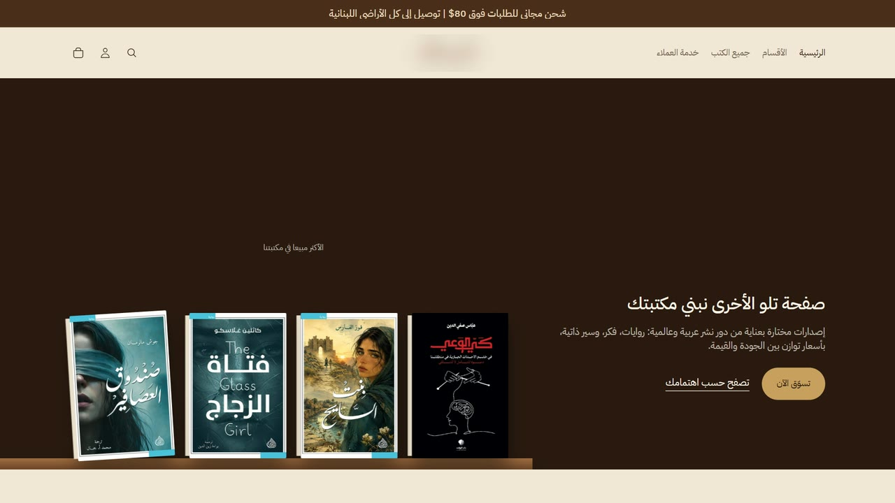
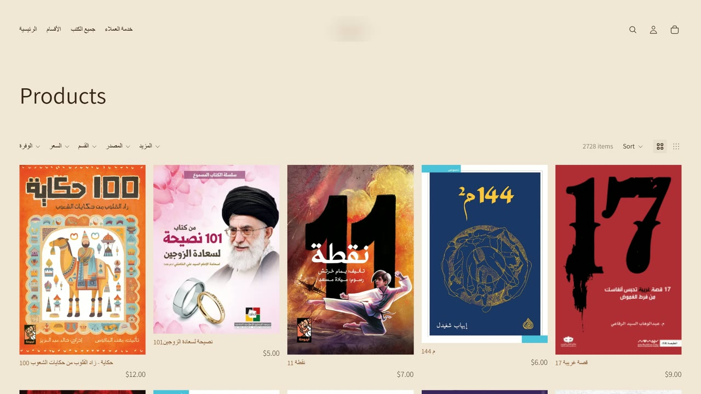
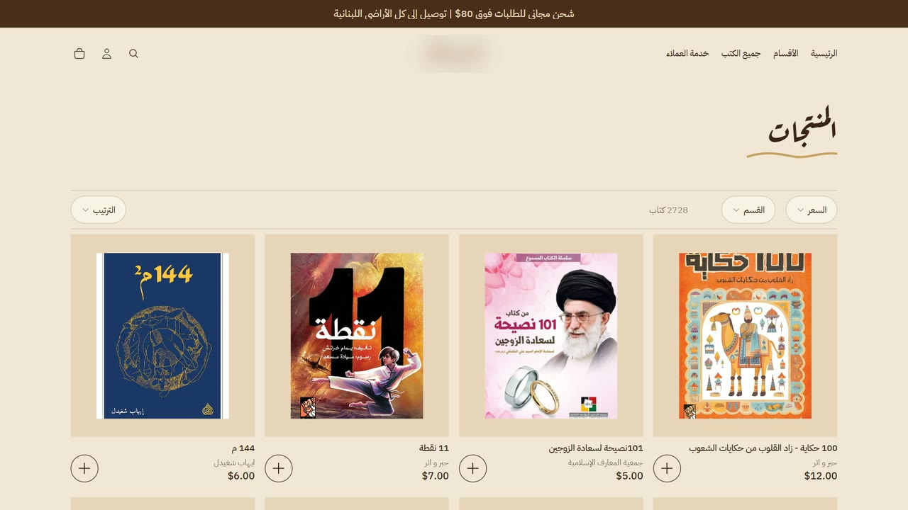
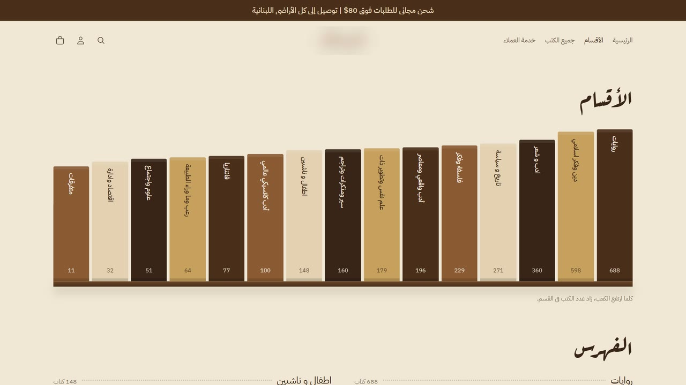
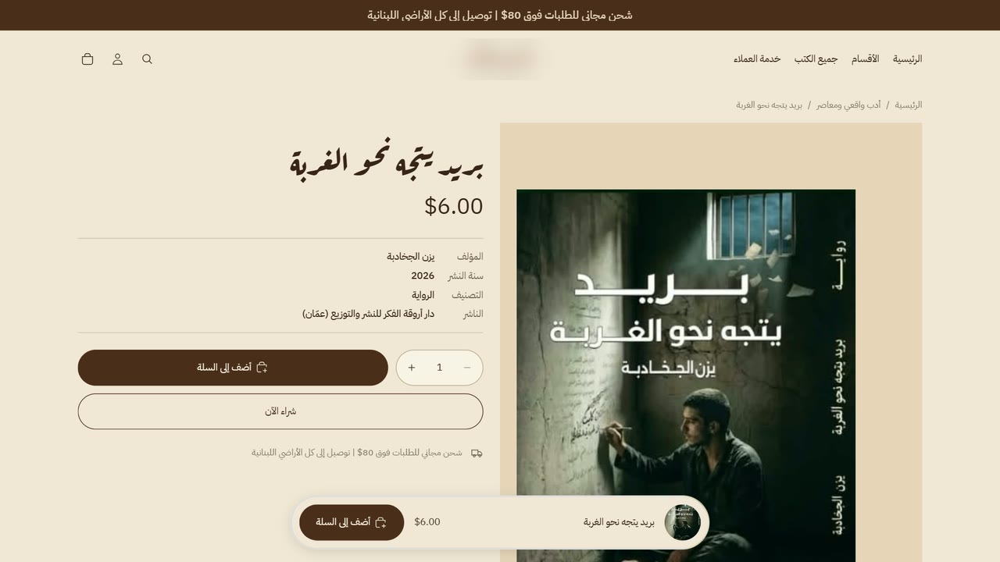

# Arabic Bookshop · Shopify Redesign

**A full redesign of a live Shopify store for an online Arabic bookshop in Lebanon, plus fixes to its search, filters and layout.**

## The problem

The shop sells about 2,700 Arabic books, but its online store didn't read like an Arabic shop:

- Pages were laid out **left to right**, as if the site were in English.
- The fonts had **no Arabic letters**, so text looked different on every phone.
- Buttons and labels were **in English** on Arabic pages.
- The home page relied on **two heavy background videos** (about 5.8 MB of an 8 MB page).
- Category filters listed **more than 80 raw tags**, and product details were loose lines of text.
- **Search-as-you-type didn't work** for Arabic, and filter menus were cut off.

## The solution

A complete Arabic redesign of the store's frontend, right to left from top to bottom, built around the books themselves: real bestsellers on a wooden shelf, categories shown as book spines, and clean product pages. Search, filters and layout bugs were fixed at the same time, with automated checks run against the store.

## Key features

- **Right to left everywhere:** layout, menus, drawers, buttons and icons all follow the Arabic reading direction.
- **Arabic typography:** a handwritten ink style for headings and a clean typeface for text.
- **Bookshelf home page:** the shop's real bestsellers on a shelf, swipeable on phones with arrows and dots.
- **Categories as book spines:** a taller spine means more books in that category.
- **Product pages** listing author, year, category and publisher, with breadcrumbs and a shipping note.
- **Book cards** with the author under the title and a one-tap add-to-cart button.
- **Arabic interface throughout**, including correct Arabic plural forms.
- **New contact page** and a "book missing from the shelf" 404 page.
- **Bugs fixed:** search-as-you-type for Arabic, clipped filter dropdowns, English sort names, and phone layout spacing.
- **Safe output:** all store text is escaped before it's displayed.

## Before and after

The shop's name and logo are hidden.

| Before | After |
| --- | --- |
|  |  |
|  |  |

  
  
  &nbsp;&nbsp;&nbsp;
  
  

Phone: home before → after, product before → after

| Categories | Product page |
| --- | --- |
|  |  |

## Tech stack

| | |
| --- | --- |
| **Platform** | Shopify (Online Store 2.0) |
| **Languages** | Liquid, CSS, JavaScript |
| **Testing** | Playwright (automated checks of cart, filters, sort and search on the real store) |
| **Version control** | Git |

---

> **Source code is private.** For hiring or client review, code access is available on request: DM [@cedarcode.lb](https://instagram.com/cedarcode.lb) or visit [cedarcodesite.com](https://cedarcodesite.com).

© 2026 CedarCode. All rights reserved.
